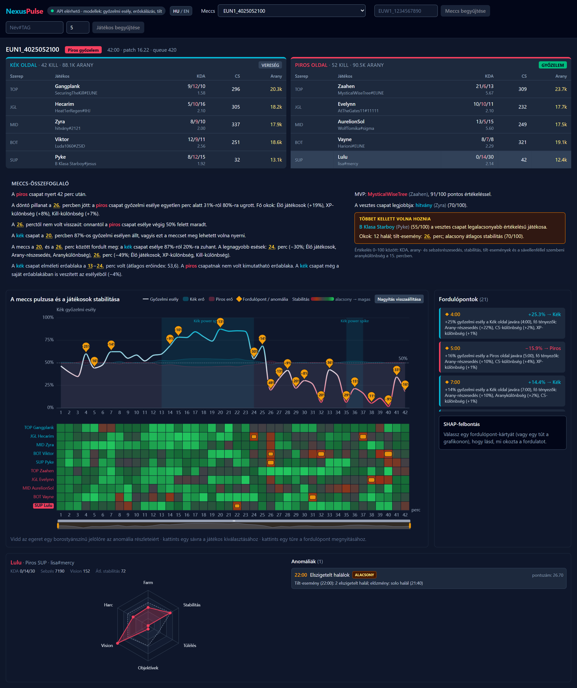
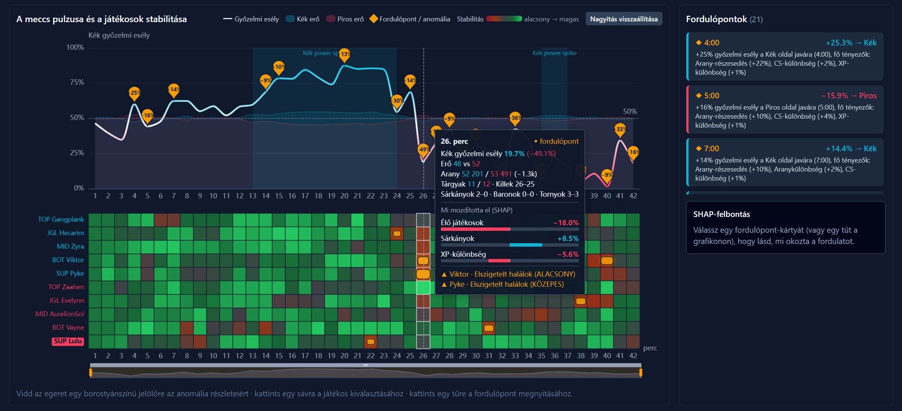
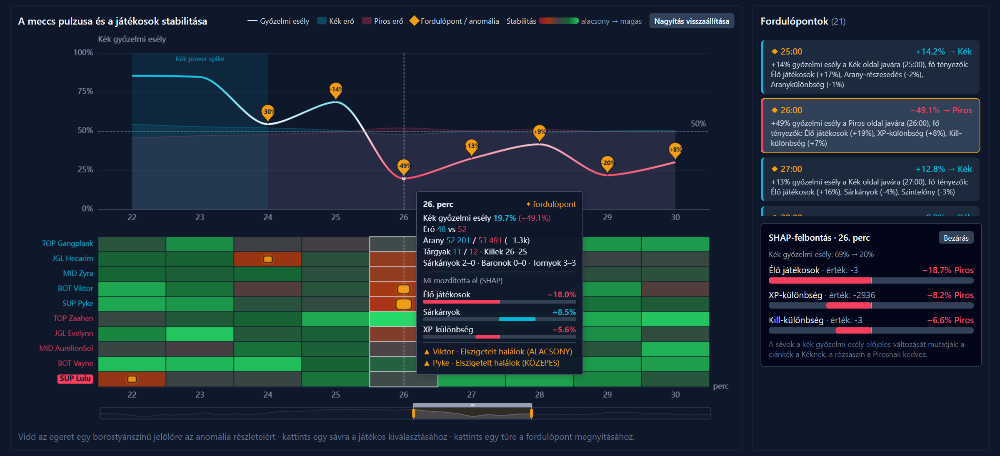
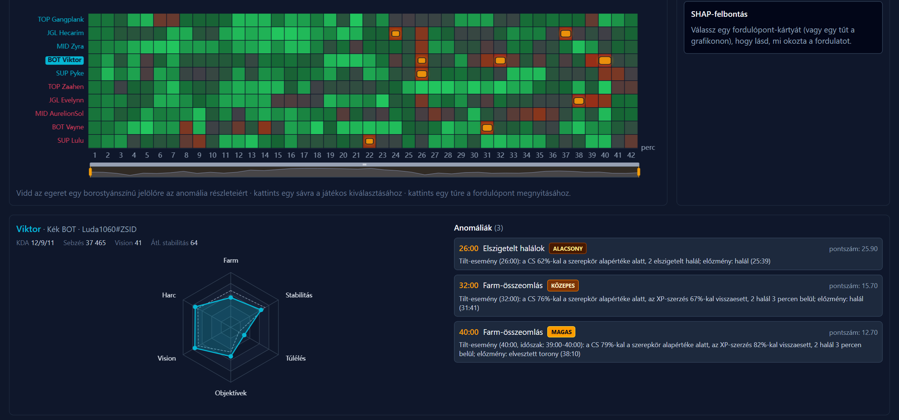
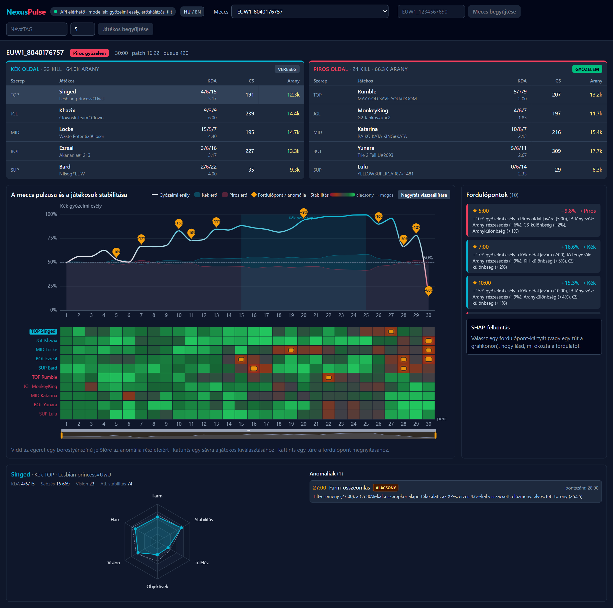
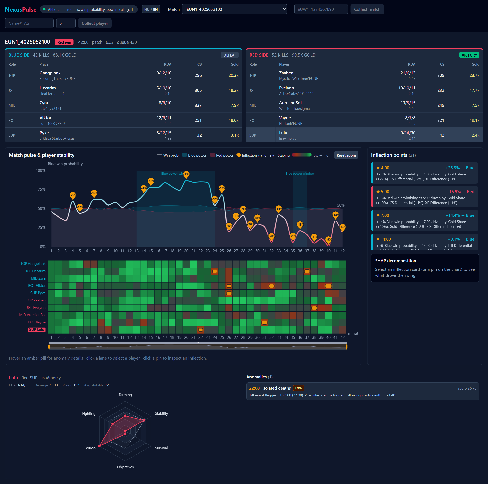
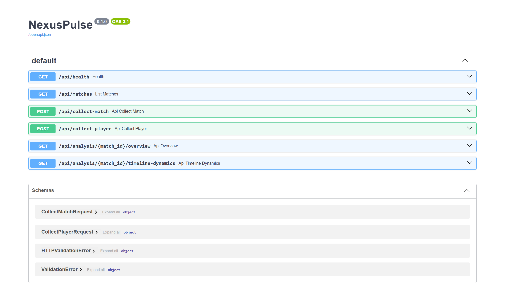

# NexusPulse – League of Legends idővonal-elemzés gépi tanulással

**Tárgy:** Alkalmazott Mesterséges Intelligencia modellek a gyakorlatban

**Feladat azonosítója:** Házi feladat (saját témájú projekt)

**Feladat címe:** A League of Legends API-ból kinyert mérkőzésadatok alapján gépi tanulási modelleket tanítok játékon belüli mintázatok és összefüggések feltárására, amelyeket egy interaktív webes felületen vizualizálok.

**Beadó:** Domokos Erik Zsolt (Neptun: I5A3X5) – egyéni munka, minden részt én készítettem (MI-eszközök segítségével, lásd a 4.4 fejezetet).

**Git repository:** https://github.com/erikzsoltdomokos/nexuspulse

**Beadás dátuma:** 2026. november 15.

## 1. Rövid összefoglaló

A projekt célja egy olyan webes elemzőplatform volt, amely a League of Legends (LoL) mérkőzések percenkénti idővonal-adataiból (Riot Games API, Match-v5 Timeline) három, egymásra épülő gépi tanulási réteggel tárja fel a meccs alakulását: (A) egy GAM-alapú „power spike” modell a csapatok elméleti erejét becsli a szintek és tárgyak alapján, (B) egy XGBoost osztályozó percenként becsli a kék csapat nyerési esélyét, és SHAP-értékekkel magyarázza a nagy kilengéseket (fordulópontokat), (C) egy szerepkörönként tanított Isolation Forest a játékosok egyéni teljesítményében keresi a statisztikai összeomlásokat („tilt”). A három réteg egyetlen, szinkronizált idővonalon jelenik meg egy React + ECharts dashboardon, magyar és angol nyelven.

A munka két nagy szakaszban zajlott. Először a Google Gemini segítségével ötleteltem: egy általános „milyen érdekes publikus API-k vannak” kérdéstől jutottam el a Riot API-ig, majd tíz projektötletből hármat választottam ki és vontam össze egy közös specifikációba. Ezt a részletes angol specifikációt változtatás nélkül adtam át a Kiro kódoló ágensnek, amely a teljes rendszert (adatgyűjtő, modellek, REST API, dashboard) megépítette. Mivel kezdetben nem volt Riot API-kulcsom, az ágens egy szintetikus, a Riot formátumát pontosan követő adatgenerátorral tette tesztelhetővé a teljes láncot; a beadás napján valódi adatokra cseréltük: 1020 Challenger-környéki rangsorolt meccset gyűjtöttünk le az EUW és EUNE szerverekről (köztük az én saját 20 meccsemet), és ezeken tanítottuk újra a modelleket.

Ami sikerült: a teljes rendszer működik valódi adatokon. A nyerési esély modell a félretett (soha nem látott) meccseken 0,837 AUC-t ér el, a 25. percben 0,918-at. A dashboard valódi meccseken mutatja a fordulópontokat és azok okait, és a saját meccseimen is felismerhető mintázatokat talál (pl. 87%-os nyerési esélyről elveszített Viktor-meccs). Ami csak részben sikerült: a tilt-detektor a meccsek 98%-ában jelez valamit, vagyis a „statisztikai anomália” nem azonos a valódi „tilttel”, és a power spike modell magyarázó ereje is szerény (R² = 0,32). Ezeket a tanulságoknál részletezem.

## 2. A megoldás felépítése

### 2.1 Architektúra

- **Backend (Python, FastAPI):** Riot API kliens rate-limit kezeléssel (20 kérés/1 s és 100 kérés/2 perc, exponenciális visszalépés 429-es válasznál), SQLite + SQLAlchemy gyorsítótár a nyers meccs- és idővonal-JSON-nak, jellemzőkinyerés, három ML modell, REST végpontok, modellverziónként gyorsítótárazott elemzések.
- **Frontend (React + Vite + TypeScript + Tailwind + ECharts):** közös időtengelyű fő grafikon (nyerési esély + elméleti erő), fordulópont-kártyák SHAP-bontással, 10 játékos stabilitási sávja tilt-jelölőkkel, radardiagram, HU/EN nyelvváltó.
- **Parancssori eszköz:** `collect-match`, `collect-player`, `crawl` (Challenger ligából induló „hógolyó” gyűjtés, `--platform` kapcsolóval több szerverre), `train`, `serve`.

### 2.2 Adatgyűjtés

| Jellemző | Érték |
|---|---|
| Valódi meccsek | 1020 (720 EUW1, 300 EUN1), mind rangsorolt solo/duo (queue 420), idővonallal |
| Ebből a saját meccseim | 20 (Riot ID: Luda1060#ZSID, EUNE) |
| Kizárt remake / korai feladás | 12 → tanításra 1008 meccs |
| Patch-ek | 16.20 (44), 16.21 (265), 16.22 (711) |
| Gyűjtési idő | ≈ 41 perc (fejlesztői kulcs, 100 kérés / 2 perc, meccsenként 2 hívás) |
| Feladással végződő meccsek | 29% |
| Kék oldal győzelmi aránya | 46–48% |

### 2.3 A három modell

**A) Power spike modell (GAM, pygam).** Bemenet: idő, szint (6/11/16-os mérföldkövek), elkészült tárgyak aranyértéke és statjai, valamint a hős skálázódási kategóriája (korai / közép / késői – kézzel összeállított táblázat, mert a Riot ilyet nem ad). Cél: a percenkénti sebzés-hatékonyság. Kimenet: 0–100 közötti csapat-erőindex és a csapatok „csúcsablaka” (pl. „Kék csúcsablak: 18–26. perc”). Valódi adaton R² = 0,318 (40 000 sor).

**B) Nyerési esély + fordulópontok (XGBoost + TreeSHAP).** Percenkénti állapotvektor: aranykülönbség és aranyarány, XP-, szint-, kill-, CS-különbség, sárkány/báró/herald/voidgrub/torony/plate/inhibitor különbségek, élő játékosok különbsége, aktív báró buff. Fordulópont: ha két egymást követő perc között |ΔP(győzelem)| ≥ 8%; ilyenkor a SHAP-értékek különbségéből a 3 legnagyobb hozzájárulót mutatja a felület. A validáció meccsek szerint történik (a meccsek 20%-a teljesen kimarad a tanításból), hogy egy meccs percei ne szivárogjanak át a tanító- és tesztkészlet között.

**C) Tilt / teljesítmény-anomália (Isolation Forest, szerepkörönként).** 3 perces csúszó ablakok játékosonként: CS-változás a szerepkör alapszintjéhez képest, izolált halálok (ellenséges területen, csapattárs nélkül – a Riot idővonal nem tartalmaz ward-pozíciókat, ezért ez közelítés), XP-gyűjtési sebesség, wardolási gyakoriság. Szerepkörönként (TOP, JUNGLE, MIDDLE, BOTTOM, UTILITY) külön modell, különben a supportok mindig „anomáliának” tűnnének. Kimenet: 0–100 stabilitási pontszám és típusos események (ISOLATED_DEATHS, FARM_COLLAPSE, XP_STALL, VISION_DROP), amelyek a kiváltó eseményt is megnevezik (halál vagy elvesztett objektív).

### 2.4 Eredmények valódi adaton

| Perc | 3 | 5 | 10 | 15 | 20 | 25 | 30 |
|---|---|---|---|---|---|---|---|
| AUC (félretett meccseken) | 0,631 | 0,744 | 0,825 | 0,880 | 0,888 | 0,918 | 0,924 |
| Értékelt meccsek | 202 | 202 | 202 | 202 | 182 | 128 | 67 |

- Teljes holdout: **AUC 0,837**, log loss 0,491, Brier 0,165 (27 428 percenkénti sor).
- Legfontosabb jellemzők (XGBoost gain): aranykülönbség 0,41, aranyarány 0,27, kill-különbség 0,09, XP-különbség 0,08, szintkülönbség 0,07; minden objektív ≤ 0,023.
- Fordulópontok: átlagosan 8,2 meccsenként; 231 meccsben (23%) a győztes nyerési esélye az 5. perc után valamikor 25% alá esett (visszafordított meccsek).
- Tilt-események: átlagosan 5,3 meccsenként, a meccsek 98%-ában legalább egy; típusok: izolált halál 3124, farm-összeomlás 1502, XP-megakadás 595, vision-csökkenés 137.

### 2.5 A dashboard



A saját meccsemen (Viktor, kék oldal, 42 perc, vereség) a kék csapat a 20. percben 87%-on állt, majd a 24. percben −30%, a 26. percben −49% esés következett; mindkettőt főleg az élő játékosok különbsége (elvesztett csapatharc), az XP és a killek magyarázzák. Utána a nyerési esély 7–44% között ingadozott a meccs végéig, én pedig izolált halált (26:00), majd farm-összeomlást (32:00, 40:00) kaptam – ez pontosan a „bedobott meccs után tiltelés” mintázat.













### 2.6 Futtatás

```
cd backend
python -m venv .venv; .\.venv\Scripts\pip install -r requirements.txt
copy .env.example .env   (RIOT_API_KEY=RGAPI-... beírása)
.\.venv\Scripts\python.exe -m nexuspulse crawl --max-matches 700 --platform euw1
.\.venv\Scripts\python.exe -m nexuspulse train --source riot
.\.venv\Scripts\python.exe -m nexuspulse serve      → http://127.0.0.1:8000/?lang=hu
```

## 3. Promptok és MI-használat

### 3.1 Ötletelés – Google Gemini

A teljes beszélgetés (saját promptjaim szó szerint, Gemini válaszai összefoglalva) a repóban: `docs/prompts/01-gemini-ideation.md`. A fő lépések:

1. „what interesting public APIs are there from which you could make interesting personal projects…” – általános API-ötletek (NASA, Spotify, Riot, ProPublica…).
2. „the riot games api is intersting. i play league, what interesting projects can i make?”
3. „…I have a university subject called Applied Artifical Inteligence Models in Practice…” – egyetemi szintű ötletek (osztályozás, klaszterezés, térbeli elemzés).
4. „I definetly want a web page where something is visualized” – Gemini egy prototípus dashboardot generált, ezt csatoltam a témabejelentő levélhez (`docs/prompts/00-topic-email.md`).
5. „irj egy mondatot” / „nem feltétlen a win%ot akarom kinyerni, ennel legyel altalanosabb” – így született a beadott témamegfogalmazás.
6. „sorolj fel 10 ilyet kezdésnek” – tíz projektötlet.
7. „…szerintem ez a 3 szorosan kapcsolódik egymáshoz … ebből a háromból alkossunk egy nagy projektet … küldj el egy részletes, angol leírást amit majd beadhatok a kiro agentemnek” – ebből lett a specifikáció (`docs/prompts/02-nexuspulse-spec.md`).

### 3.2 Megvalósítás – Kiro ágens

| # | Prompt (szó szerint) | Eredmény |
|---|---|---|
| 1 | „Start a new project with the following specification: …” + a Gemini-specifikáció | Az ágens először rákérdezett a hiányosságokra: nincs ward-pozíció az idővonalban, nincs hivatalos hős-skálázódási adat, a fejlesztői kulcs 24 óránként lejár, a tilt-alapszintnek szerepkörönkéntinek kell lennie. |
| 2 | „no need to save tokens for now. do as much as you can, you have free rein” | A teljes 4 fázis elkészült: a backendet a fő ágens, a React dashboardot egy párhuzamos al-ágens írta egy rögzített API-szerződés alapján; 12/12 teszt, szintetikus adatokon. |
| 3 | „okay, we need to finish this project. as of today i will have to draft a document … what do you need so we can procceed” | Az ágens összegyűjtötte a hiányzó információkat (azonosító, név, nyelv, formátum, valódi adat, repo). |
| 4 | Válaszok: név/Neptun, „docs all in hungarian … maybe the site can also be set up to be displayed in hungarian too”, „yes, we should collect real data” | HU/EN nyelvváltó (al-ágens), prompt-dokumentáció, publikus GitHub repo. |
| 5 | „my riot id is Luda1060#ZSID but i play on eune, maybe support for multiple regions?” | `--platform` kapcsoló, a saját 20 meccsem letöltése, majd 1000 meccs gyűjtése és újratanítás valódi adaton; remake-szűrés. |

## 4. Tanulságok

### 4.1 Adat és modellezés

1. **A valódi adat mást tanít, mint a szintetikus.** A szintetikus generátor nagyon hasznos „állvány” volt: kulcs nélkül is végig lehetett építeni és tesztelni a teljes láncot. Az ottani számok (AUC 0,65 az 5., 0,87 a 25. percben) viszont semmit sem mondtak a valódi játékról. A valódi adatban a meccsek 29%-a feladással ér véget, rövidebbek a meccsek (≈ 26–27 perc vs. 29,4), és a piros oldal kicsit többet nyer – ezek egyike sem volt benne a szintetikus világban.
2. **Az adattisztítás többet hozott, mint bármilyen modellhangolás.** 12 remake/korai feladás (pl. egy 2 perces „meccs” győztessel) zajos címkeként került a tanítóhalmazba. Kiszűrésük egyetlen sor logika volt, és a holdout AUC 0,821-ről 0,837-re javult.
3. **A meccsenkénti validációs felosztás kötelező.** Egy meccs percenkénti sorai erősen korrelálnak; soronkénti véletlen felosztással a modell „látná” a tesztmeccsek más perceit, és irreálisan jó eredményt mutatna.
4. **A SHAP a modellt magyarázza, nem a játékot.** A modell szerint az arany dominál (0,41 + 0,27), az objektívek (sárkány, báró) alig számítanak. Ez nem azt jelenti, hogy a báró lényegtelen, hanem hogy a hatása már az aranykülönbségben megjelenik – a korreláló jellemzők között a modell „szétosztja” a hatást. Az ok-okozati következtetéshez óvatosnak kell lenni.
5. **A „fordulópont” definíciója tervezési döntés.** A késői játékban egy elvesztett csapatharc (élő játékosok különbsége) egy perc alatt 40–60%-ot mozgat a nyerési esélyen. Ez valósághű, de a fix 8%-os küszöb miatt meccsenként átlagosan 8,2, hosszú meccseken 20+ fordulópont jön ki – így a felhasználó számára kevésbé olvasható. Időfüggő küszöb vagy simítás lenne a következő lépés.
6. **Címkék nélkül egy anomália-detektor nem validálható.** A tilt-detektor a valódi meccsek 98%-ában jelez; sok jelzés egyszerűen egy elvesztett harc utáni természetes visszaesés, nem „tilt”. Az Isolation Forest azt találja meg, ami statisztikailag ritka – hogy ez pszichológiailag tilt-e, azt csak címkézett adat (pl. saját utólagos értékelés) tudná eldönteni.
7. **Az elméleti modell gyengébb, mint vártam.** A power spike GAM R² = 0,32: a hősök skálázódása a valóságban sokkal zajosabb, mint egy kézzel összeállított korai/közép/késői kategória. Ez is eredmény – a „papíron erősebb” csapat gyakran nem az, amelyik nyer.
8. **A késői percek eredményei bizonytalanok.** A 30. percben már csak 67 holdout-meccs maradt, ezért az ottani 0,924-es AUC-nek nagy a szórása. 1000 meccs elég a működéshez, de kevés a késői játék megbízható méréséhez.

### 4.2 Adatgyűjtés és API

9. **Az API-korlátok határozzák meg a projekt ütemezését.** Fejlesztői kulccsal 1000 meccs ≈ 41 perc, a kulcs 24 óránként lejár. Ezt a Gemini is előre jelezte – érdemes korán elkezdeni a gyűjtést.
10. **A régiók logikája nem triviális.** Az EUW és EUNE ugyanabba a „europe” regionális útvonalba tartozik, ezért a saját EUNE-meccseim módosítás nélkül működtek; csak a Challenger-liga lekérdezése szerverfüggő. Mellékhatás: az EUNE-gyűjtés 20 EUW-meccset is hozott, mert egy játékos meccslistája az egész régiót lefedi.
11. **Bizonyos adatok egyszerűen nem léteznek.** A specifikáció „wardolatlan területen bekövetkezett halálokat” kért, de az idővonal nem tartalmaz ward-pozíciókat – ezt csak közelíteni lehetett. Egy jó specifikáció is tartalmazhat megvalósíthatatlan elemet; az ágens ezt még kódolás előtt jelezte.

### 4.3 Munka MI-ágensekkel

12. **A specifikáció minősége meghatározza az eredményt.** A Geminivel készített részletes specifikáció (modulok, algoritmusok, API-szerződés, színek) után az ágens egy menetben felépítette a rendszert. Hasznos volt két különböző modellt használni: az egyiket ötletelésre, a másikat megvalósításra.
13. **A rögzített API-szerződés lehetővé tette a párhuzamos munkát.** A backendet és a frontendet két ágens párhuzamosan írta; mivel a JSON-formátum előre rögzítve volt, az összekötésnél egyik oldalon sem kellett módosítani.
14. **Az ágens „kész” állítását ellenőrizni kell.** Az első integrációnál a dashboard üres képernyővel nyílt meg; a hover-tooltipeket és a kattintásos zoomot kezdetben csak statikus képernyőképeken ellenőrizte. A tesztek (12 → 15) és a valódi böngészős kipróbálás nélkül ezek a hibák rejtve maradtak volna.
15. **A futtatási környezet korlátai is tanulságosak.** Az ágens biztonsági szabályai egy ártalmatlan parancsot tévesen blokkoltak, a háttérben indított hosszú adatgyűjtés pedig csendben leállt, mert az ágens futtatókörnyezete leállítja a gyermekfolyamatokat. A megoldás: rövidebb, előtérben futó adagok egy al-ágensben, miközben a fő ágens a dokumentációt írta.
16. **Az MI gyorsít, de a döntések az emberé maradnak.** Melyik három ötletet vonjam össze, valódi vagy szintetikus adattal adjak-e be, és hogyan értelmezzem a túl gyakori tilt-jelzéseket – ezeket nekem kellett eldöntenem.

### 4.4 Saját tapasztalataim

<!-- TODO Erik: 3–5 mondat saját szavaiddal – mi lepett meg, mi volt nehéz, mit csinálnál másképp. -->
[KITÖLTENDŐ]

## 5. Továbbfejlesztési lehetőségek

- Időfüggő fordulópont-küszöb, az élő játékosok különbségének simítása.
- A tilt-detektor kalibrálása címkézett saját meccsekkel; játékosonkénti (nem csak szerepkörönkénti) alapszint.
- Több adat (több ezer meccs, több patch) a késői percek megbízhatóbb méréséhez.
- Draft-szinergia és jungler-útvonal modulok a Gemini-féle tízes listából.
- Éles üzemhez: Riot produkciós kulcs, hitelesítés az API előtt.
